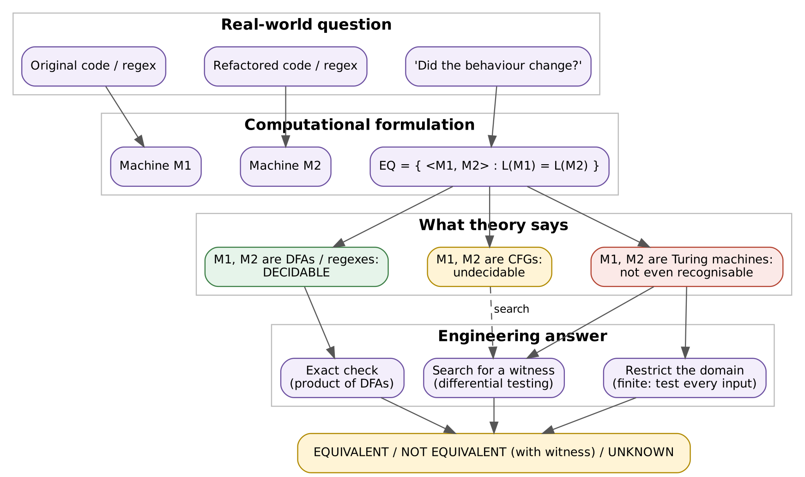
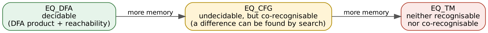
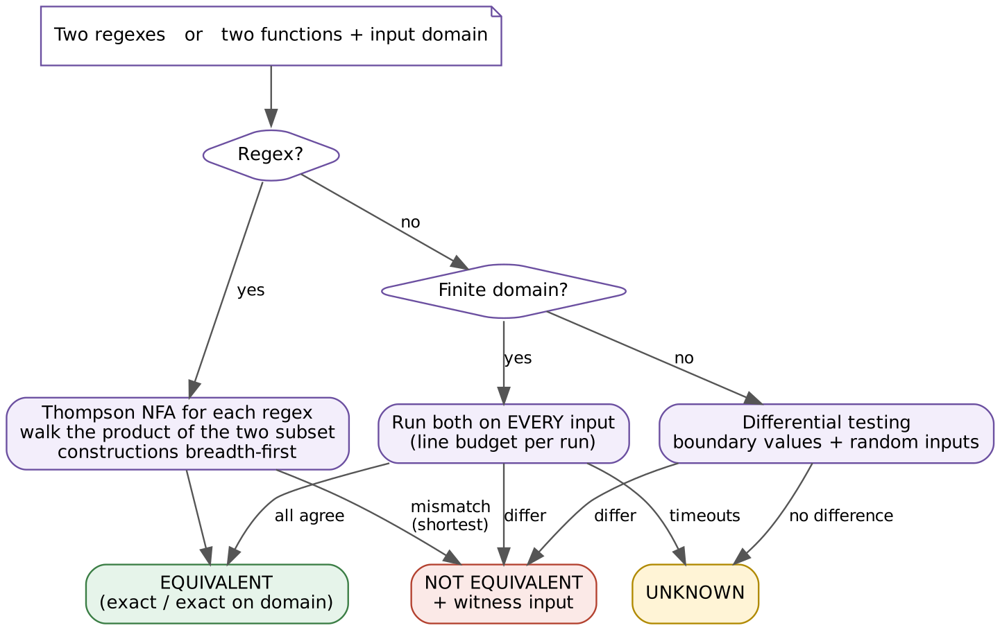

# EquivCheck: Program Equivalence Checking and Its Limits

**Course:** 21CSC301T Formal Language and Automata, CLA-2, Assessment Task 4 (team work)
**Team:** Neelesh R (RA2411026050034) and Harini K K (RA2411026050041), B.Tech AIML 'A', III year
**Faculty:** Dr. C. Gunasundari, Assistant Professor, Department of AIML, SRM IST Tiruchirappalli
**Problem chosen:** (c) program equivalence checking

When a developer refactors a function or rewrites a validation regex, the real
question is: *did the behaviour change?* This project formalises that
question, shows where it is decidable and where it is not, and builds a
checker that answers honestly within those limits.

## 1. The decision problem

| Real world | Formal model |
|---|---|
| original program / regex | machine M1 |
| refactored program / regex | machine M2 |
| "same behaviour on every input?" | ⟨M1, M2⟩ ∈ EQ, where EQ = { ⟨M1, M2⟩ : L(M1) = L(M2) } |
| "on which input do they differ?" | a string in the symmetric difference L(M1) △ L(M2) |



How hard EQ is depends entirely on the machine model:



* **EQ_DFA is decidable.** Build the product automaton and check whether any
  reachable state pair has exactly one accepting component. Regular
  expressions convert to DFAs, so regex equivalence is decidable too.
* **EQ_CFG is undecidable.** It is co-recognisable: if two grammars differ,
  enumerating strings and testing membership (CYK) will eventually find the
  difference.
* **EQ_TM is neither recognisable nor co-recognisable.** Reduction from HALT:
  for a program P build Q_P(x) = "run P, then return 0" and Z(x) = 0. Then Q_P
  and Z are equivalent ⇔ P halts. A decider for EQ_TM would therefore decide
  HALT, which is impossible. Rice's theorem gives the same conclusion for every
  non-trivial behavioural property.

## 2. The tool



EquivCheck never claims a general algorithm. It answers **EQUIVALENT**,
**NOT EQUIVALENT** (always with a witness input) or **UNKNOWN**.

| Situation | Method | What the answer means |
|---|---|---|
| two regular expressions | Thompson NFA for each, then a breadth-first walk over the product of the two subset constructions | exact; the witness is a **shortest** separating string |
| two functions, finite input domain | run both on **every** input, each run limited by a line budget | exact on that domain, unless a run times out |
| two functions, unbounded domain | differential testing: boundary values + random inputs | a difference is a proof; no difference is only evidence (UNKNOWN) |

A run that exceeds the budget is a TIMEOUT, and two TIMEOUTs are never treated
as equal. That is deliberate: we cannot tell "loops forever" from "slow",
which is the halting problem showing up in practice.

## 3. Results

### The reduction, run against real checkers (`python -m equivcheck.cli theory`)

```
checker_syntax   (compare source code)          wrong on P = halts_now, halts_after_5000
checker_testing  (timeout = difference)         wrong on P = halts_after_5000
checker_lenient  (skip timeouts)                wrong on P = loops_forever
```

Every candidate is wrong for at least one P.

### Regex benchmark: decidable, 10/10 exact

| pair | regex 1 | regex 2 | verdict | shortest witness |
|---|---|---|---|---|
| star_of_union | `(a\|b)*` | `(a*b*)*` | EQUIVALENT | |
| shifted_loop | `a(ba)*` | `(ab)*a` | EQUIVALENT | |
| optional_prefix | `x?y` | `y\|xy` | EQUIVALENT | |
| double_star | `a**` | `a*` | EQUIVALENT | |
| phone_digits | `[0-9]+(-[0-9]+)*` | `[0-9]([0-9]\|-[0-9])*` | EQUIVALENT | |
| username_rule | `[a-z][a-z0-9_]*` | `[a-z]([a-z]\|[0-9]\|_)*` | EQUIVALENT | |
| pairs_vs_blocks | `(ab)*` | `a*b*` | NOT EQUIVALENT | `a` |
| second_last_one | `(0\|1)*1(0\|1)` | `(0\|1)*1` | NOT EQUIVALENT | `1` |
| pin_refactor_bug | `[0-9][0-9][0-9][0-9]` | `[0-9][0-9][0-9][0-9]?` | NOT EQUIVALENT | `000` |
| email_tld_bug | `[a-z]+@[a-z]+\.[a-z][a-z]+` | `[a-z]+@[a-z]+\.[a-z]+` | NOT EQUIVALENT | `a@a.a` |

### Program benchmark: restricted cases, 8 decided, 2 UNKNOWN, 0 wrong

| pair | truth | method | verdict | witness / note |
|---|---|---|---|---|
| sum_loop_vs_formula | equivalent | all 301 inputs | EQUIVALENT | |
| abs_two_ways | equivalent | all 1 001 inputs | EQUIVALENT | |
| swap_xor_trick | equivalent | all 4 096 inputs | EQUIVALENT | |
| fast_power | equivalent | all 156 inputs | EQUIVALENT | |
| max3_refactor | differ | all 343 inputs | NOT EQUIVALENT | (-2, -2, -3) |
| leap_year_bug | differ | all 201 inputs | NOT EQUIVALENT | 2000 |
| off_by_one | differ | all 50 inputs | NOT EQUIVALENT | 1 |
| collatz_small | equivalent on 1..1999 | all 1 999 inputs | EQUIVALENT | |
| collatz_unbounded | open problem | 3 004 sampled inputs | UNKNOWN | |
| slow_vs_fast | equivalent | all 5 inputs | UNKNOWN | 5 timeouts |

The full output is in [`docs/sample_output.txt`](docs/sample_output.txt).

## 4. Run it

```bash
pip install -r requirements.txt          # only pytest
python -m equivcheck.cli all             # reduction demo + both benchmarks
python -m equivcheck.cli regex "(ab)*" "a*b*"   # check your own pair of regexes
python -m pytest -q                      # 41 tests
python tools/make_diagrams.py            # rebuild diagrams (needs Graphviz)
```

Pure Python 3.9+, no other libraries.

## 5. What this means in practice

* Refactoring tools can **prove** equivalence only in restricted settings:
  regular languages, finite domains, or code simple enough for a solver.
* Test suites and fuzzers are witness searches. They can prove that two
  versions differ, never that they are the same.
* Regex rewrites are the happy case. They are fully decidable, so tooling can
  and should check them exactly.
* Treat a timeout as "unknown", never as "equal" or "different".

## Layout

```
equivcheck/regex_equiv.py   regex parser, Thompson NFA, product-of-subsets equivalence, shortest witness
equivcheck/prog_equiv.py    line-budgeted execution, exhaustive and differential checking
equivcheck/reduction.py     HALT -> EQ reduction, run against three candidate checkers
equivcheck/benchmark.py     regex and program pairs with hand-checked ground truth
equivcheck/cli.py           command-line demo
tests/                      41 tests (incl. cross-checks against Python's re and brute force)
tools/make_diagrams.py      diagrams in docs/diagrams
```

See [CONTRIBUTIONS.md](CONTRIBUTIONS.md) for who did what.
